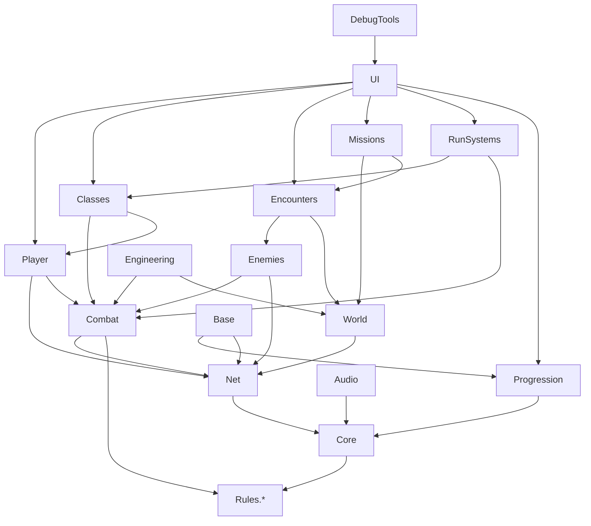

# Architecture

This document describes how Deadfall's code is organised, which systems own what, how they depend on each other, and how networking fits in. It is the reference for every implementation milestone. Update it whenever a system's responsibility or dependency changes.

## 1. Guiding rules

1. **Three layers.** Pure rules (no Unity), Unity runtime systems, and presentation. Rules are where balance-sensitive maths lives, so it can be unit-tested fast and without the editor.
2. **Data-driven content.** Weapons, classes, enemies, waves, rooms, upgrades, events, and missions are ScriptableObject *definitions*. Adding content means adding assets, not code.
3. **Host-authoritative outcomes.** Anything that decides a result (damage, death, spawns, loot, rewards, unlocks, wave state) runs on the host. Clients send *requests*.
4. **Network-ready from day one, playable offline.** Every gameplay system talks to an authority abstraction. Single player is "host with zero clients", so there is one code path, not two.
5. **No god objects.** Systems are small services with one job, discovered through a service registry and connected by events.
6. **Assembly boundaries enforce dependencies.** Each module is an `.asmdef`. If a reference isn't in the asmdef, the code can't take the dependency. This prevents circular dependencies by construction.
7. **Pool everything that spawns repeatedly.** Enemies, projectiles, VFX, decals, audio sources, pickups.

## 2. Layers

```
┌───────────────────────────────────────────────────────────┐
│ Presentation  (UI Toolkit, VFX, audio, animation, camera)  │  reads state, raises intents
├───────────────────────────────────────────────────────────┤
│ Runtime systems  (MonoBehaviours, NetworkBehaviours,       │  owns scene objects, ticks,
│ services, pooling, NavMesh, physics queries)              │  bridges to rules
├───────────────────────────────────────────────────────────┤
│ Rules  (plain C#, noEngineReferences: damage maths, ammo  │  deterministic, unit-tested
│ state machines, wave planning, map graph, upgrades,       │
│ economy, save model, RNG)                                 │
└───────────────────────────────────────────────────────────┘
```

The Rules assemblies (`Deadfall.Rules.*`) set `noEngineReferences: true`. They use our own `Float3`-free numeric inputs where possible (plain floats/ints), and a seeded RNG (`DeterministicRandom`, xoshiro128**) so the same seed produces the same map and encounter rolls on every machine.

## 3. Folder structure

```
Assets/_Project/
  Art/            Models, Materials, Textures, Animations, VFX, Shaders (Shader Graph only)
  Audio/          SFX, Music, Ambience, Mixers
  Data/           ScriptableObject instances, one folder per definition type
    Classes/ Weapons/ Attachments/ Enemies/ Bosses/ Waves/ Difficulty/
    Upgrades/ Events/ Missions/ Rooms/ Environments/ Structures/ Economy/ Synergies/
  Prefabs/        Player, Enemies, Weapons, Structures, Rooms, Pickups, UI, Systems
  Scenes/
    Bootstrap/    Bootstrap.unity (first scene in build; creates services)
    Base/         FOB scene
    Deployment/   Deployment shell scene (rooms are spawned into it)
    Sandbox/      Test scenes per milestone (movement, combat, AI, generation)
  Settings/       URP assets, Input Actions, Audio mixer, quality tiers
  Scripts/
    Rules/        Deadfall.Rules.*        (no UnityEngine)
    Core/         Deadfall.Core           bootstrap, services, events, state, scenes, save IO, logging
    Net/          Deadfall.Net            NGO wrapper, authority, session, sync helpers
    Player/       Deadfall.Player         controller, camera, health, interaction, downed/revive
    Combat/       Deadfall.Combat         weapons runtime, hitscan/projectiles, damage pipeline, melee
    Classes/      Deadfall.Classes        abilities, passives, skill trees, synergy
    Enemies/      Deadfall.Enemies        AI, enemy manager, bosses
    Encounters/   Deadfall.Encounters     wave manager, spawn director, events, difficulty
    World/        Deadfall.World          map generation runtime, doors, power, interactables
    Engineering/  Deadfall.Engineering    placement, structures, scrap
    Missions/     Deadfall.Missions       objectives, mission flow
    RunSystems/   Deadfall.RunSystems     run upgrades, modifiers, run state
    Progression/  Deadfall.Progression    profile, unlocks, research, mastery, challenges
    Base/         Deadfall.Base           FOB stations
    UI/           Deadfall.UI             screens, HUD, view models
    Audio/        Deadfall.Audio          audio service, pooled emitters
    Debug/        Deadfall.DebugTools     cheats, overlays, gizmos (excluded from release)
  Tests/
    EditMode/     Deadfall.Tests.EditMode (Rules + Core logic)
    PlayMode/     Deadfall.Tests.PlayMode (integration: movement, combat, waves, generation)
  UI/             UXML, USS, fonts, icons
```

## 4. Modules and responsibilities

| Module | Owns | Key types (planned) |
|---|---|---|
| **Rules.Common** | RNG, stat modifiers, IDs, math helpers | `DeterministicRandom`, `StatBlock`, `Modifier`, `ModifierStack`, `ContentId` |
| **Rules.Combat** | Damage formula, crits, weak points, armor, ammo/reload state machine, recoil/spread curves | `DamageCalculator`, `DamageRequest`, `DamageResult`, `AmmoState`, `WeaponStateMachine` |
| **Rules.Encounters** | Wave composition planning, threat budgets, difficulty curves, event weighting | `WavePlanner`, `ThreatBudget`, `DifficultyCurve`, `WeightedTable<T>` |
| **Rules.World** | Map graph generation and validation (abstract sockets, bounds, connectivity) | `LayoutGenerator`, `LayoutGraph`, `LayoutValidator` |
| **Rules.Progression** | Upgrade rolling, stacking rules, economy, reward retention, save model and migrations | `UpgradeRoller`, `RewardCalculator`, `ProfileData`, `SaveMigrator` |
| **Core** | Bootstrap, `ServiceRegistry`, `EventBus`, game state machine, scene loading, save IO, logging, config | `GameBootstrap`, `GameStateMachine`, `SceneService`, `SaveService` |
| **Net** | NGO lifecycle, host/join, Relay/Lobby, `IAuthority`, request validation, compact snapshot channels | `SessionService`, `NetAuthority`, `EnemySnapshotChannel` |
| **Player** | Kinematic controller, camera, look, health, status effects, interaction, downed/revive/spectate | `PlayerMotor`, `PlayerLook`, `Health`, `Interactor`, `DownedState` |
| **Combat** | Equipped weapons, firing, hitscan, projectiles, melee sweeps, hit zones, damage pipeline, feedback events | `WeaponRuntime`, `HitscanFirer`, `ProjectilePool`, `MeleeSweep`, `Hurtbox`, `DamagePipeline` |
| **Classes** | Class runtime, abilities, passives, skill trees, synergy | `ClassDefinition`, `AbilityDefinition`, `AbilityRunner`, `SynergyResolver` |
| **Enemies** | Enemy definitions, pooled agents, time-sliced AI, targeting, attacks, bosses | `EnemyDefinition`, `EnemyManager`, `EnemyBrain`, `BossDefinition`, `BossPhaseRunner` |
| **Encounters** | Wave manager, spawn director, spawn points, random events, adaptive difficulty | `WaveManager`, `SpawnDirector`, `EventDirector`, `DifficultyService` |
| **World** | Room prefabs, socket matching, runtime assembly, NavMesh bake, doors, locks, power grid, interactables, expansion | `RoomDefinition`, `MapBuilder`, `Door`, `PowerNode`, `SectionUnlocker` |
| **Engineering** | Scrap, placement validation, structure lifecycle | `PlacementValidator`, `StructureDefinition`, `StructureRuntime` |
| **Missions** | Objective definitions and runtime, mission flow, extraction defense | `MissionDefinition`, `ObjectiveDefinition`, `ObjectiveTracker` |
| **RunSystems** | Run state (temporary), upgrade offers, run modifiers | `RunState`, `UpgradeOfferService` |
| **Progression** | Persistent profile, unlocks, research, mastery, challenges, prestige | `ProfileService`, `ResearchService`, `ChallengeTracker` |
| **Base** | FOB stations that open screens and launch deployments | `StationInteractable`, `DeploymentLauncher` |
| **UI** | Screens, HUD, view models bound to events | `HudController`, `UpgradeChoiceScreen` |
| **Audio** | Mixer, pooled 3D emitters, priority/voice limiting | `AudioService` |

## 5. Dependency diagram

Arrows mean "depends on". Anything not shown is not allowed.



Rules for cross-module talk:
- **Downward calls** (e.g. Encounters → Enemies) use direct interfaces.
- **Upward or sideways notifications** (e.g. an enemy died, and UI, Progression, and RunSystems care) use the `EventBus` with struct events (`EnemyKilled`, `WaveStarted`, `DamageApplied`). No allocation per publish.
- Presentation never mutates gameplay state directly. It raises intents (`RequestReload`, `RequestUpgradePick`) that go through authority.

## 6. Data flow examples

**Firing a weapon (client in a networked game)**
1. Input → `WeaponRuntime` (owner). Local `WeaponStateMachine` (Rules) checks fire rate and ammo; plays muzzle VFX, recoil, sound immediately.
2. Owner runs the hitscan locally against current enemy positions, producing `HitClaim{targetNetId, hurtboxZone, weaponId, shotIndex, origin, dir}`.
3. Claim is sent to the host (batched per tick).
4. Host `DamagePipeline` validates (fire-rate budget, ammo budget, max range, rough line-of-sight, target alive), runs `DamageCalculator` (Rules) with the shooter's current modifiers, applies the result.
5. Host broadcasts `DamageApplied` (target, amount, crit, killed). Clients show hit markers and damage numbers from the authoritative result. The shooter shows a provisional hit marker instantly and corrects if rejected (rare).

**Enemy killed**
Host `Health` reaches zero → `EnemyKilled` event → `WaveManager` decrements remaining, `RewardService` grants field credits, `ChallengeTracker` counts, `LootService` rolls drop with the run RNG → spawn replicated pickup. Enemy returns to pool.

**Deployment start**
Lobby confirms loadouts → host picks seed → `LayoutGenerator` (Rules) builds a graph from `EnvironmentDefinition` → `LayoutValidator` checks it → host sends seed + environment id to clients → every peer builds identical rooms locally from the seed (no geometry over the wire) → host bakes NavMesh (only the host runs AI) → spawns network objects (doors, stations, objectives).

## 7. Networking approach

**Framework:** Netcode for GameObjects 2.x in host mode, with Unity Relay + Lobby for NAT-free player hosting. Rationale and FishNet comparison: `DECISIONS.md` T-03.

**Authority split**

| State | Authority | Sync method |
|---|---|---|
| Player movement | Owner client (client-authoritative transform), host sanity-checks speed/teleport | `NetworkTransform` (owner-auth, interpolated, half-precision) |
| Look direction | Owner | Packed in a per-tick owner state |
| Player health, downed, status | Host | `NetworkVariable` |
| Ammo / reload | Owner predicts, host keeps a budget to validate claims | Owner state + host budget |
| Hit detection | Owner claims, host validates and resolves | RPC batches |
| Enemy spawn, AI, health, death | Host only | Custom compact snapshot channel (see below) |
| Projectiles (slow, e.g. grenades, acid) | Host spawns; clients simulate visually from spawn params | Spawn message, no per-tick sync |
| Waves, events, objectives, doors, power | Host | `NetworkVariable` / small state objects |
| Map layout | Host picks seed, all peers generate | Seed message |
| Loot rolls, upgrade offers, rewards | Host | RPC to recipients |
| Engineer structures | Host (client requests placement) | Network objects, pooled |
| Persistent profile | Each player's own machine | Never written by the host (see §8) |

**Enemy sync.** Making 60–100 zombies full `NetworkObject`s with `NetworkTransform` costs too much bandwidth and CPU. Instead, enemies are pooled locally on every peer and identified by a 16-bit slot index. The host sends a compact snapshot (slot, quantised position, yaw, anim state, health %) at 10–15 Hz, prioritising nearby/visible enemies; clients interpolate. Spawn and death are reliable events. Bosses may be full `NetworkObject`s since there is only one.

**Feel under latency.** Movement and shooting feedback are local and instant. Only the damage *result* waits for the host, which is acceptable in PvE. No rollback or lag compensation rewind is planned; the host validates against a tolerance window instead.

**Disconnects.** Host migration is not supported (`DECISIONS.md` D-16). A client drop leaves its character downed in place and frees its loadout; a rejoin within a time window restores it. Host drop ends the deployment for everyone with failure-retention rewards.

## 8. Persistence

- **Profile data** (`ProfileData`, versioned): progression, unlocks, currency, research, mastery, achievements, cosmetics, settings. Stored per machine at `Application.persistentDataPath/profiles/<slot>.json`.
- **Deployment data** (`RunState`): seed, wave, objectives, temporary upgrades, field credits, scrap. Lives in memory on the host. A lightweight checkpoint is written at the end of each wave so a crash can be reported and failure rewards still granted on next launch. Runs are not resumable mid-deployment in the prototype.
- **Writes are atomic**: write `*.tmp`, flush, rename over the target, keep one `*.bak`. On load: parse → validate → migrate (`SaveMigrator` chains `vN→vN+1`) → if invalid, fall back to `.bak`, then to a fresh profile with the corrupted file kept aside.
- **Rewards at run end** are computed by the host (`RewardCalculator` in Rules), sent to each client, and each client applies them to its own profile. Clients reject rewards outside configured bounds. This keeps co-op simple and is honest about trust: a friend's host is trusted for a co-op PvE game.

Outcome table (detail in `GAME_DESIGN.md` §9):

| Outcome | Temporary upgrades | Field credits/scrap | Permanent rewards |
|---|---|---|---|
| Success | Lost | Lost | 100% |
| Failure | Lost | Lost | Retention % (config) |
| Player eliminated, team succeeds | Lost | Lost | 100% |
| Client disconnects | Lost | Lost | Retention % up to the drop point |
| Host disconnects | Lost | Lost | Retention % up to the last checkpoint |
| Game crash | Lost | Lost | Retention % from last checkpoint, granted next launch |

## 9. Runtime conventions

- **Bootstrap.** `Bootstrap.unity` is build index 0. `GameBootstrap` creates services, loads settings and profile, then loads the base scene. Any scene can be played directly in the editor: a `[RuntimeInitializeOnLoadMethod]` hook loads the bootstrap services if missing.
- **Fast enter-play-mode safe.** No static state without an explicit reset in `[RuntimeInitializeOnLoadMethod(SubsystemRegistration)]`.
- **Ticking.** Gameplay MonoBehaviours avoid individual `Update` where many instances exist. `EnemyManager` ticks AI in time slices (e.g. 1/4 of enemies per frame for decisions; locomotion every frame via NavMeshAgent). Perception runs at 5–10 Hz.
- **Movement.** Kinematic controller on `CharacterController`, simulated in `Update` with exponential, framerate-independent acceleration; camera look in `LateUpdate` from raw mouse delta (never multiplied by `deltaTime`). Weapon logic driven by timestamps, not frame counts.
- **No per-frame allocations** in gameplay loops. Use `NonAlloc` physics queries, pooled lists, struct events.
- **Physics layers** defined once in `Settings/PhysicsLayers` and referenced by a generated constants class.

## 10. Development conventions

- C# naming: `PascalCase` types and public members, `_camelCase` private fields, `camelCase` locals. One public type per file, file name = type name.
- Namespaces mirror assemblies: `Deadfall.Combat`, `Deadfall.Rules.Combat`.
- ScriptableObject definitions end in `Definition` (`WeaponDefinition`). Asset files are named `<Type>_<Name>` (`Weapon_M4Carbine`, `Enemy_Husk`).
- Every definition has a stable `ContentId` (string GUID-like) used in saves and network messages. Never save asset paths or names.
- Serialized fields use `[SerializeField] private`, not public fields.
- Tunable numbers live in definitions or config assets, never as literals in logic.
- Comments explain *why*. Complex algorithms get a header comment.
- Git: small commits, imperative messages (`Add ammo state machine`), one feature per branch, `main` always opens and compiles. Large binaries go through Git LFS (`.gitattributes` provided).

## 11. Technical risks

| # | Risk | Impact | Mitigation |
|---|---|---|---|
| R1 | Unity cannot run in the cloud dev environment; code written there is unverified until opened in the editor | High | Keep logic in Rules assemblies with EditMode tests; add GitHub Actions with GameCI to compile and run tests on every push (needs a Unity license secret); the user runs a short manual check per increment |
| R2 | Horde scale (CPU): NavMeshAgent + Animator cost per zombie | High | Time-sliced AI, Animator culling, LOD, population caps, profile at M2; vertex-animation shader for distant zombies if needed |
| R3 | Enemy sync bandwidth with 4 players and large hordes | High | Custom compact snapshot channel, relevance prioritisation, 10–15 Hz, measure in M11 (planned early spike in M2/M3) |
| R4 | Runtime NavMesh baking on generated maps (time, hitches, door links) | Medium | Bake per room section asynchronously, use NavMeshLinks at sockets, bake new sections when unlocked |
| R5 | Procedural maps that are valid but boring | Medium | Hand-authored rooms with tags, graph templates per mission type, critical-path + branch structure, playtest seeds library |
| R6 | Scope: 5 classes × trees, 9 environments, 3 modes | High | Prototype scope (Part 23) is the gate; content after systems are stable |
| R7 | Retrofitting multiplayer | High | Authority abstraction from M1, a host+client smoke test at end of M1–M3 |
| R8 | Fast enter-play-mode bugs from static state | Low | Convention §9, a test that enters play mode twice |
| R9 | Relay/Lobby service quota and account setup | Low | Free tier covers development; direct IP connect kept as a dev fallback |
| R10 | Save corruption or schema changes losing progress | Medium | Versioned migrations, atomic writes, backups, tests for each migration |
